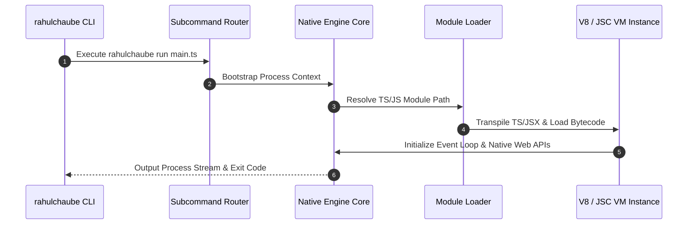

# Explanation: Architecture & System Lifecycle

- **Category**: Explanations (Diátaxis)
- **Version**: v1.0.0
- **Last Updated**: 2026-07-26
- **Status**: Implemented

---

## Overview
A deep technical explanation of the internal execution lifecycle, process bootstrapping, module loading, and plugin routing in RahulChaube Runtime.

---

## Process Bootstrapping Pipeline

---

## Memory & Execution Lifecycle
1. **CLI Phase**: The binary inspects environment flags and parses terminal arguments.
2. **Resolution Phase**: Dependencies and workspace imports are validated against `package.json` and `bun.lock`.
3. **Execution Phase**: Native engine boots V8/JSC VM, registers Web Standard APIs (`fetch`, `Crypto`, `WebSocket`), and enters the event loop.
4. **Diagnostic Phase**: If an unhandled error occurs, `rahulchaube explain` hooks inspect the stack trace to suggest corrective actions.

---

## Related Pages
- [Tutorial: First Steps](/docs/tutorials/first-steps)
- [Reference: CLI Commands](/docs/reference/cli-reference)
