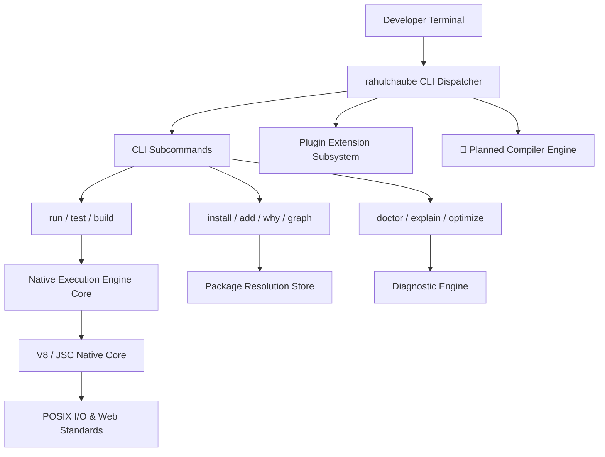

# Runtime Architecture — RahulChaube Runtime

> **Status**: Implemented

## Overview
RahulChaube Runtime follows a decoupled two-tier architecture separating the high-speed execution core from the TypeScript developer CLI surface.

---

## Architectural System Diagram

---

## Core Subsystems

### 1. CLI Dispatcher (`packages/rahulchaube-cli`)
Handles argument parsing, sub-command routing, terminal styling, diagnostic inspection (`doctor`, `explain`), and ASCII graph generation (`graph`).

### 2. Native Engine Core
Executes JavaScript and TypeScript natively with Web Standard APIs (`fetch`, `Request`, `Response`, `WebSocket`, `Crypto`).

### 3. Package Resolution Engine
Uses content-addressable storage to link downloaded dependencies into workspace `node_modules` and maintains `rahulchaube.lock` lockfile compatibility.

### 4. Plugin Ecosystem
Enables custom CLI extensions named using the `rahulchaube-plugin-*` prefix pattern.

---

## Related Pages
- [Runtime Overview](/docs/runtime/overview)
- [CLI Reference](/docs/cli/overview)
